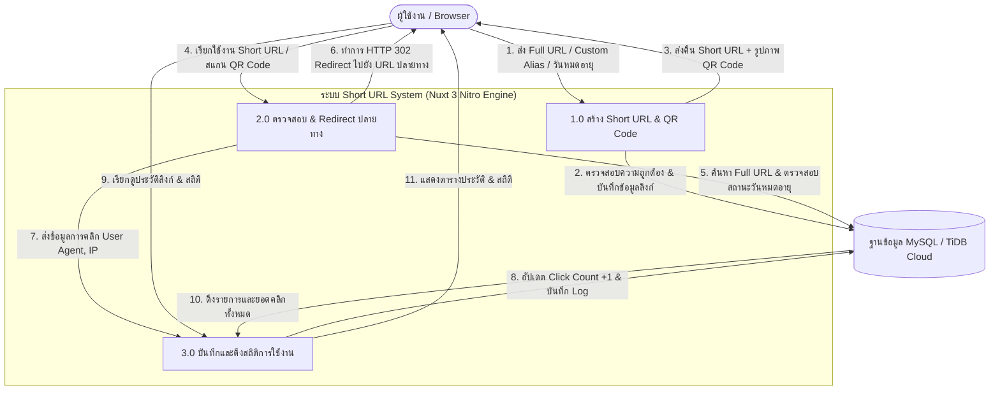
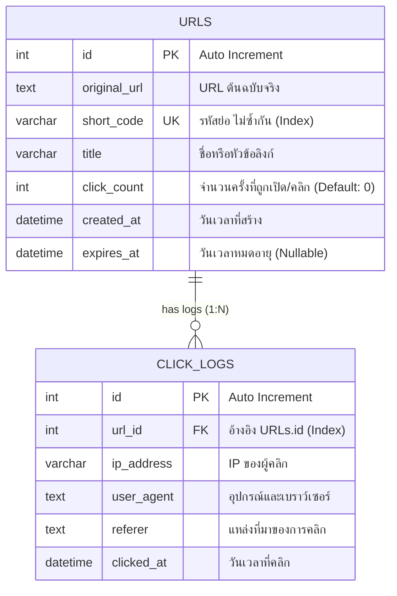
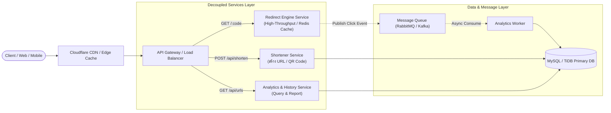

# 🔗 SYNERY Short URL System (ระบบย่อลิงก์และวิเคราะห์สถิติ)

> **ข้อสอบสำหรับทดสอบ Developer: ออกแบบและพัฒนาระบบ Short URL**  
> พัฒนาโดย: **Peerapat**  
> Live Production URL: [https://synerrytest-short-url.vercel.app](https://synerrytest-short-url.vercel.app)  
> Repository: [https://github.com/Peerapat2256/synerrytest_Short_URL-](https://github.com/Peerapat2256/synerrytest_Short_URL-)

---

## 📋 ภาพรวมระบบและฟังก์ชันการทำงาน

ระบบ Short URL ที่ออกแบบและพัฒนาขึ้นมาเพื่อตอบสนองเกณฑ์การประเมินอย่างครบถ้วน:
1. **Shorten URL**: แปลง Long URL ให้เป็นรหัสสั้นกระชับ (Base62 Nanoid) พร้อมตรวจสอบความถูกต้องของ URL
2. **Instant Redirect**: เมื่อเปิด Short URL ระบบจะค้นหาและทำการ **HTTP 302 Redirect** ไปยัง URL ปลายทางจริง
3. **QR Code Generation**: สร้างภาพ QR Code คุณภาพสูงสำหรับสแกนเข้า URL ได้ทันที พร้อมปุ่มดาวน์โหลดภาพ `.png`
4. **History & Analytics**: แสดงประวัติลิงก์ทั้งหมด พร้อมจำนวนสถิติคนคลิกแบบ Real-time
5. **Special Features (พิจารณาเป็นพิเศษ)**:
   - **Custom Alias**: สามารถกำหนดชื่อสั้นที่ต้องการเองได้ (เช่น `/my-custom-link`)
   - **Link Expiry**: สามารถกำหนดวันหมดอายุของลิงก์ได้ (1 วัน, 7 วัน, 30 วัน หรือถาวร)
   - **Click Analytics Logs**: บันทึก IP Address, User Agent (อุปกรณ์/เบราว์เซอร์) และ Referrer ทุกครั้งที่มีการคลิก

---

## 📐 1. Data Flow Diagram (DFD Level 0)

แสดงภาพรวมการไหลของข้อมูลระหว่าง User, ระบบ Short URL Service และ Database:



---

## 🗄️ 2. Database Design (ER Diagram)

ระบบใช้ฐานข้อมูล **MySQL (TiDB Cloud Serverless)** โดยออกแบบโครงสร้าง 3NF รองรับการเก็บสถิติและขยายตัว:



---

## 🏗️ 3. Architecture Diagram (Microservices-Oriented)

เพื่อรองรับปริมาณ Traffic การคลิกจำนวนมหาศาล (High Read/Write Asymmetry) ระบบถูกออกแบบสถาปัตยกรรมแบบ **Microservices-Ready**:



* **High Read Availability**: ส่วน Redirect แยกการทำงานเป็นอิสระ สามารถต่อ Redis Caching เพื่อให้การ Redirect เร็วต่ำกว่า 10ms
* **Asynchronous Logging**: การเก็บสถิติคลิกทำงานแบบ Non-blocking ไม่ทำให้ผู้ใช้ที่คลิกลิงก์ต้องรอนาน

---

## 📂 4. โครงสร้างโปรเจกต์ (Layered Architecture)

จัดระเบียบโค้ดตามหลัก **Layered Architecture (Separation of Concerns)** แยกส่วน Frontend และ Backend (Controller, Service, Repository, Model) ออกจากกันอย่างชัดเจน:

```text
synerry-shorturl/
├── app/                              # [Frontend Layer - Nuxt / Vue 3]
│   ├── assets/css/main.css           # Tailwind CSS
│   ├── layouts/default.vue           # โครงสร้าง Navbar & Layout หลัก (<slot />)
│   ├── model/url.model.ts            # โครงสร้างข้อมูล Model ฝั่งหน้าบ้าน
│   ├── pages/index.vue               # หน้าเพจหลัก (สร้างลิงก์, QR Code, ตารางสถิติ)
│   └── app.vue                       # Root Component (<NuxtLayout><NuxtPage /></NuxtLayout>)
│
├── server/                           # [Backend Layer - Nuxt Nitro Layered Architecture]
│   ├── api/                          # 1. Presentation / Controller Layer (รับ-ส่ง HTTP JSON)
│   │   ├── shorten.post.ts           # POST /api/shorten
│   │   ├── urls.get.ts               # GET /api/urls
│   │   └── urls/
│   │       ├── [id].delete.ts        # DELETE /api/urls/:id
│   │       └── [id]/logs.get.ts      # GET /api/urls/:id/logs
│   ├── middleware/
│   │   └── redirect.ts               # Redirect Controller (GET /:code -> HTTP 302)
│   ├── controller/dto/               # Data Transfer Objects (Request/Response DTO)
│   │   └── url.dto.ts
│   ├── service/                      # 2. Service Layer (Business Logic & QR Generation)
│   │   └── url.service.ts
│   ├── repository/                   # 3. Repository Layer (Database Access & SQL Queries)
│   │   ├── dbconnect.ts              # การเชื่อมต่อฐานข้อมูล TiDB MySQL
│   │   └── url.repository.ts         # คำสั่ง SQL ติดต่อตาราง urls และ click_logs
│   ├── model/                        # 4. Model Layer (Database Schema Entities)
│   │   ├── url.model.ts
│   │   └── clickLog.model.ts
│   └── utils/                        # Dependency Injection Container & Helpers
│       ├── container.ts
│       └── urlHelper.ts
```

---

## 🛠️ Tech Stack ที่เลือกใช้

- **Frontend**: Vue 3 (Composition API), Nuxt 3, Tailwind CSS, Lucide Icons
- **Backend API**: Node.js, Nuxt Nitro Serverless Engine
- **Database**: MySQL Compatible (TiDB Cloud Serverless AWS Singapore)
- **Driver / Libraries**: `mysql2`, `qrcode`, `nanoid`
- **Deployment**: Vercel Serverless Platform

---

## 🚀 วิธีการติดตั้งและรันโปรเจกต์ (Local Development)

### ข้อกำหนดเบื้องต้น (Prerequisites)
- Node.js version 18.x หรือใหม่กว่า (แนะนำ Node.js v20+)
- npm หรือ pnpm

### ขั้นตอนการรัน
1. **Clone Repository**
   ```bash
   git clone https://github.com/Peerapat2256/synerrytest_Short_URL-.git
   cd synerrytest_Short_URL-
   ```

2. **ติดตั้ง Dependencies**
   ```bash
   npm install
   ```

3. **ตั้งค่า Environment Variables**
   สร้างไฟล์ `.env` ที่ root directory (หรือก๊อปปี้จาก `.env.example`):
   ```env
   DB_HOST=gateway01.ap-southeast-1.prod.aws.tidbcloud.com
   DB_PORT=4000
   DB_USERNAME=3NQ7BdWo4atCyZj.root
   DB_PASSWORD=KkJ21lQQvI0TG00S
   DB_DATABASE=test
   ```

4. **รันเซิร์ฟเวอร์สำหรับทดสอบ (Development Mode)**
   ```bash
   npm run dev
   ```
   เปิดเว็บเบราว์เซอร์ไปที่: `http://localhost:3000`

5. **Build สำหรับ Production**
   ```bash
   npm run build
   node .output/server/index.mjs
   ```
