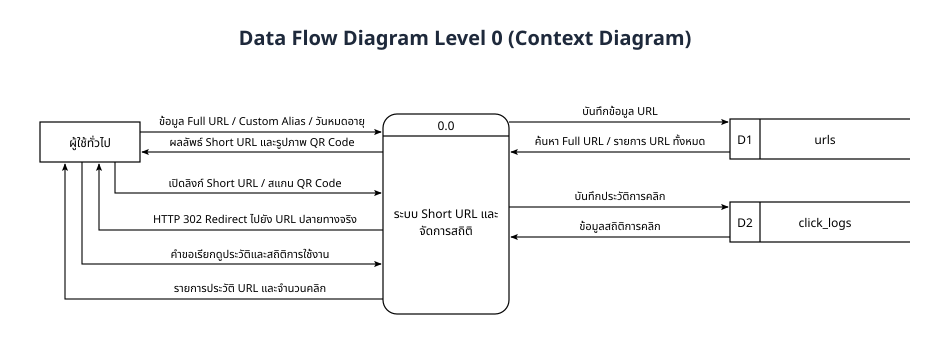
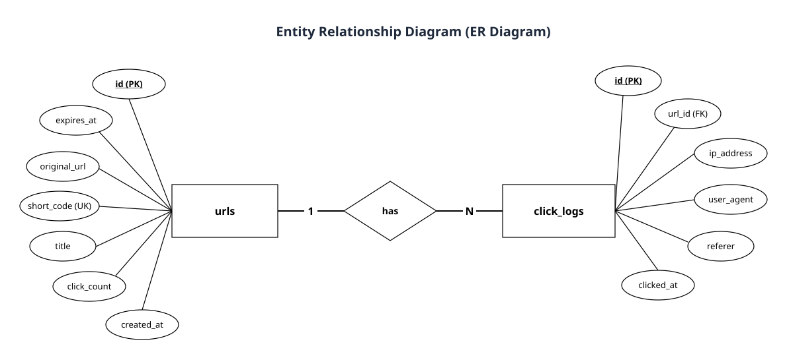
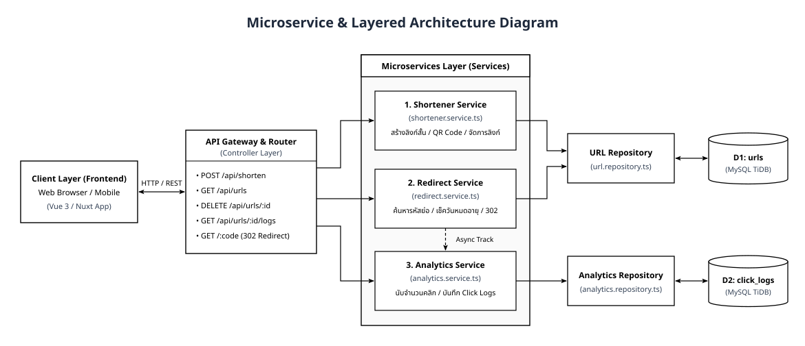

# SYNERY Short URL System

ระบบออกแบบและพัฒนา Short URL สำหรับทดสอบตำแหน่ง Developer (SYNERY CORPORATION)

- **Live URL:** [https://synerrytest-short-url.vercel.app](https://synerrytest-short-url.vercel.app)
- **Repository:** [https://github.com/Peerapat2256/synerrytest_Short_URL-](https://github.com/Peerapat2256/synerrytest_Short_URL-)

---

## ฟังก์ชันการทำงานหลัก

1. **สร้าง Short URL:** แปลง Full URL เป็นรหัสสั้น (Base62) พร้อมตรวจสอบความถูกต้องของ URL
2. **Redirect ไปยัง URL ต้นแบบ:** เมื่อเปิดใช้งาน Short URL ระบบจะค้นหาข้อมูลและทำการ HTTP 302 Redirect ไปยัง URL ต้นทาง
3. **สร้าง QR Code:** สร้าง QR Code ของแต่ละ Short URL สำหรับสแกนเข้าถึงเว็บไซต์ต้นทาง พร้อมปุ่มดาวน์โหลดไฟล์ PNG
4. **เก็บประวัติและสถิติการคลิก:** แสดงรายการประวัติ URL ที่สร้างทั้งหมด สถิติจำนวนครั้งที่คลิก และประวัติการคลิกเชิงลึก (IP Address, User Agent, Referer, วันเวลาที่คลิก)
5. **ฟังก์ชันเพิ่มเติม:**
   - กำหนดชื่อลิงก์สั้นด้วยตัวเอง (Custom Alias)
   - กำหนดวันหมดอายุของลิงก์ (Expiration Date)

---

## 1. Data Flow Diagram (DFD Level 0)



*(ไฟล์ต้นฉบับ draw.io: [`dfd_level_0.drawio`](./dfd_level_0.drawio))*

---

## 2. Database Design (ER Diagram)

ใช้ฐานข้อมูล **MySQL (TiDB Cloud)** แบ่งออกเป็น 2 ตารางหลัก (`urls` และ `click_logs`) ความสัมพันธ์แบบ One-to-Many (1:N):



*(ไฟล์ต้นฉบับ draw.io: [`er_diagram.drawio`](./er_diagram.drawio))*

---

## 3. Architecture Diagram (Microservice & Layered Architecture)

ระบบแบ่งการทำงานฝั่ง Backend ออกเป็น **3 Domain Microservices** ทำงานร่วมกับ **API Gateway** และ **Repository Layer**:

1. **Shortener Service (`shortener.service.ts`):** จัดการการสร้าง Short URL, ตรวจสอบ Custom Alias, สร้าง QR Code และจัดการรายการลิงก์
2. **Redirect Service (`redirect.service.ts`):** ค้นหารหัสย่อ (`short_code`), ตรวจสอบวันหมดอายุ และทำ HTTP 302 Redirect
3. **Analytics Service (`analytics.service.ts`):** นับสถิติการคลิก (`click_count`) และบันทึกข้อมูลการเข้าชม (`click_logs`) แบบ Asynchronous



*(ไฟล์ต้นฉบับ draw.io: [`architecture_diagram.drawio`](./architecture_diagram.drawio))*

---

## 4. โครงสร้างโปรเจกต์ (Microservices & Layered Architecture)

```text
synerry-shorturl/
├── app/                              # Frontend (Vue 3 / Nuxt)
│   ├── assets/css/main.css           # Tailwind CSS
│   ├── layouts/default.vue           # Layout หลักและ Navbar
│   ├── model/url.model.ts            # โครงสร้างข้อมูล Model ฝั่ง Frontend
│   ├── pages/index.vue               # หน้าเพจหลัก
│   └── app.vue                       # Root Component
│
├── server/                           # Backend (Node.js / Nitro)
│   ├── api/                          # API Gateway / Controller Layer (REST API)
│   │   ├── shorten.post.ts           # POST /api/shorten -> Shortener Service
│   │   ├── urls.get.ts               # GET /api/urls -> Shortener Service
│   │   └── urls/
│   │       ├── [id].delete.ts        # DELETE /api/urls/:id -> Shortener Service
│   │       └── [id]/logs.get.ts      # GET /api/urls/:id/logs -> Analytics Service
│   ├── middleware/
│   │   └── redirect.ts               # GET /:code -> Redirect & Analytics Service
│   ├── controller/dto/
│   │   └── url.dto.ts                # Data Transfer Objects
│   ├── service/                      # Microservices Layer (Domain Services)
│   │   ├── shortener.service.ts      # 1. Shortener & QR Code Service
│   │   ├── redirect.service.ts       # 2. Redirect Resolution Service
│   │   └── analytics.service.ts      # 3. Click Tracking & Analytics Service
│   ├── repository/                   # Data Access Layer (SQL Queries)
│   │   ├── dbconnect.ts              # Database Connection Pool
│   │   ├── url.repository.ts         # Repository ตาราง urls
│   │   └── analytics.repository.ts   # Repository ตาราง click_logs
│   ├── model/
│   │   ├── url.model.ts              # Entity Model ตาราง urls
│   │   └── clickLog.model.ts         # Entity Model ตาราง click_logs
│   └── utils/
│       ├── container.ts              # Service Container & Dependency Injection
│       └── urlHelper.ts              # URL Validation & Code Generator
```

---

## 5. วิธีการติดตั้งและรันโปรเจกต์

1. **Clone Repository**
   ```bash
   git clone https://github.com/Peerapat2256/synerrytest_Short_URL-.git
   cd synerrytest_Short_URL-
   ```

2. **ติดตั้ง Dependencies**
   ```bash
   npm install
   ```

3. **ตั้งค่า Environment Variables**
   สร้างไฟล์ `.env` ที่ root directory:
   ```env
   DB_HOST=gateway01.ap-southeast-1.prod.aws.tidbcloud.com
   DB_PORT=4000
   DB_USERNAME=3NQ7BdWo4atCyZj.root
   DB_PASSWORD=KkJ21lQQvI0TG00S
   DB_DATABASE=test
   ```

4. **รันโหมดพัฒนา (Development)**
   ```bash
   npm run dev
   ```
   เข้าใช้งานที่ `http://localhost:3000`

5. **Build สำหรับใช้งานจริง (Production)**
   ```bash
   npm run build
   node .output/server/index.mjs
   ```
